# Guía de uso de QA Dashboard

QA Dashboard es una app de escritorio para registrar los tests que haces cada día (funcionales, exploratorios, re-tests…) y las suites grandes (Smoke, Regression). Trae tus tickets de Jira para que registres un test con un clic y te muestra métricas de tu trabajo: ejecuciones, casos, pass rate, bugs y tiempo.

Todo funciona en tu equipo: no hay servidor en la nube y tus datos no salen de tu máquina, salvo las consultas que la app hace a tu propio Jira.

> Las capturas de esta guía usan datos de ejemplo (`example.atlassian.net`). Tu pantalla mostrará tus propios tickets y registros.

## Contenido

1. [Abrir la app](#1-abrir-la-app)
2. [Primer inicio](#2-primer-inicio)
3. [Conectar Jira](#3-conectar-jira)
4. [Registrar un test desde un ticket](#4-registrar-un-test-desde-un-ticket)
   - [Validar un ticket con el orquestador QA](#validar-un-ticket-con-el-orquestador-qa)
5. [Registrar un test sin ticket (Smoke, Regression…)](#5-registrar-un-test-sin-ticket-smoke-regression)
   - [Ejecutar la regresión con Claude Code](#ejecutar-la-regresión-con-claude-code)
6. [Leer el dashboard](#6-leer-el-dashboard)
7. [Buscar, editar, duplicar y borrar registros](#7-buscar-editar-duplicar-y-borrar-registros)
8. [Personalizar tipos de test y ambientes](#8-personalizar-tipos-de-test-y-ambientes)
9. [Respaldo y exportación](#9-respaldo-y-exportación)
10. [Atajos de teclado](#10-atajos-de-teclado)
11. [Solución de problemas](#11-solución-de-problemas)

---

## 1. Abrir la app

**Si te pasaron `QA Dashboard.app`:**

1. Arrastra `QA Dashboard.app` a la carpeta **Aplicaciones**.
2. La primera vez, haz **clic derecho → Abrir** y confirma con **Abrir**. macOS lo pide porque la app no está firmada; las siguientes veces basta con doble clic.
3. Para tenerla siempre a mano: con la app abierta, clic derecho en su icono del Dock → **Opciones → Mantener en el Dock**.

**Si tienes el código del proyecto** (necesitas Node.js 20 o superior):

```bash
npm install            # solo la primera vez
npm run desktop        # abre la app de escritorio
npm run desktop:pack   # genera release/mac-*/QA Dashboard.app
```

La ventana recuerda su tamaño y posición, así que se abre donde la dejaste.

## 2. Primer inicio

La primera vez verás el **Dashboard** vacío con una guía de **Empieza en dos pasos**:

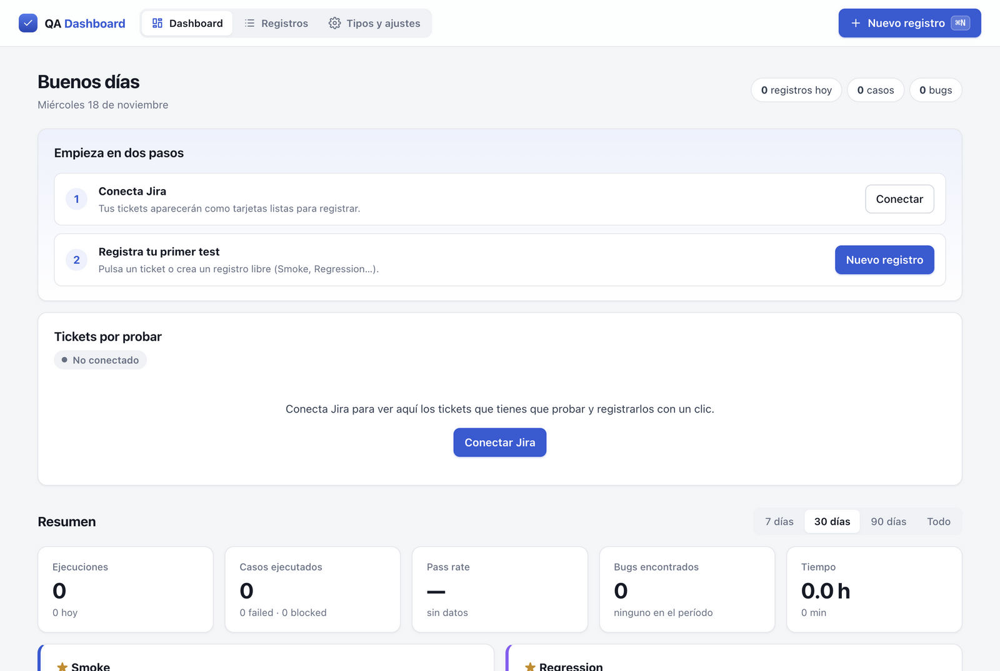

1. **Conecta Jira**: para ver tus tickets como tarjetas (sección 3). Es opcional, pero es lo que más tiempo ahorra.
2. **Registra tu primer test**: con **Nuevo registro** o pulsando un ticket.

La guía desaparece en cuanto guardas tu primer registro.

En la parte superior tienes siempre las tres vistas de la app (**Dashboard**, **Registros** y **Tipos y ajustes**) y el botón **Nuevo registro**.

## 3. Conectar Jira

### 3.1 Crea un API token de Atlassian

La app se conecta a Jira con tu email y un API token (no con tu contraseña).

1. Abre <https://id.atlassian.com/manage-profile/security/api-tokens> (también está el enlace **Crear un API token en Atlassian** dentro de la app).
2. Pulsa **Create API token**, ponle un nombre (por ejemplo «QA Dashboard») y elige la caducidad.
3. Copia el token. Atlassian solo lo muestra una vez.

### 3.2 Completa la conexión

Ve a **Tipos y ajustes** (o pulsa **Conectar Jira** en el dashboard) y busca la tarjeta **Conexión con Jira**:

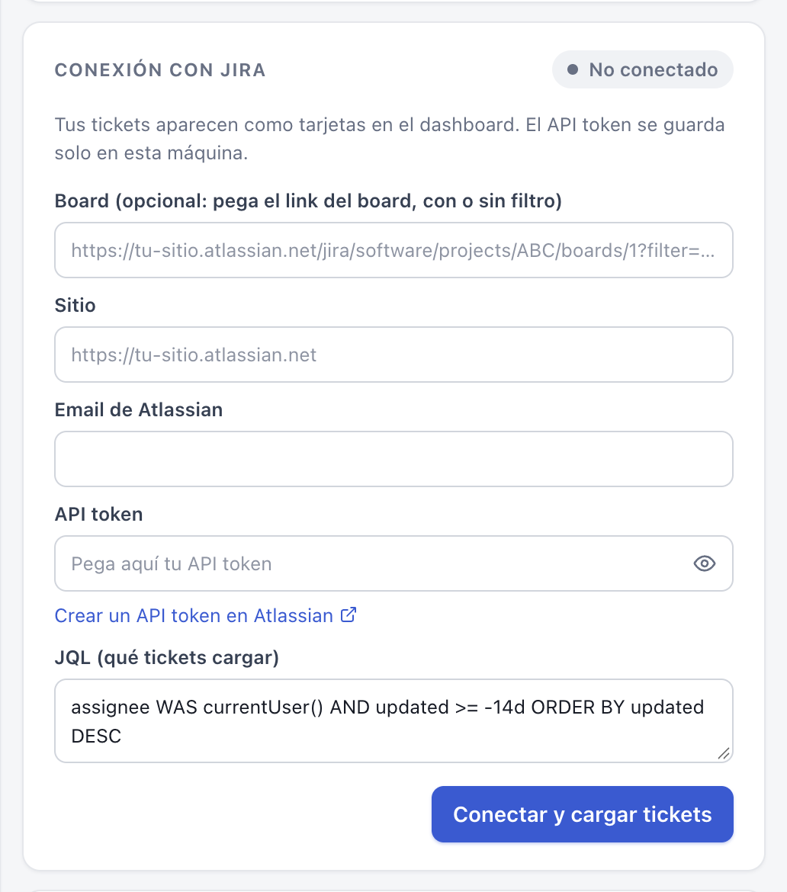

| Campo | Qué poner |
| --- | --- |
| **Board** | El link de tu board de Jira, copiado tal cual del navegador. Si el board tiene filtro de personas (`?filter=assignee+IN+(...)`), también se usa. Es opcional: sin board, la app usa el JQL. |
| **Sitio** | Se llena solo al pegar el board (`https://tu-sitio.atlassian.net`). Sin board, escríbelo a mano. |
| **Email de Atlassian** | El email con el que entras a Jira. |
| **API token** | El token del paso anterior. El icono del ojo lo muestra u oculta. |
| **JQL adicional** | Con board: un filtro extra opcional (ver abajo). Sin board: la búsqueda completa. |

Pulsa **Conectar y cargar tickets**. Si todo va bien, el indicador pasa a **Conectado** y aparece el aviso «Jira conectado».

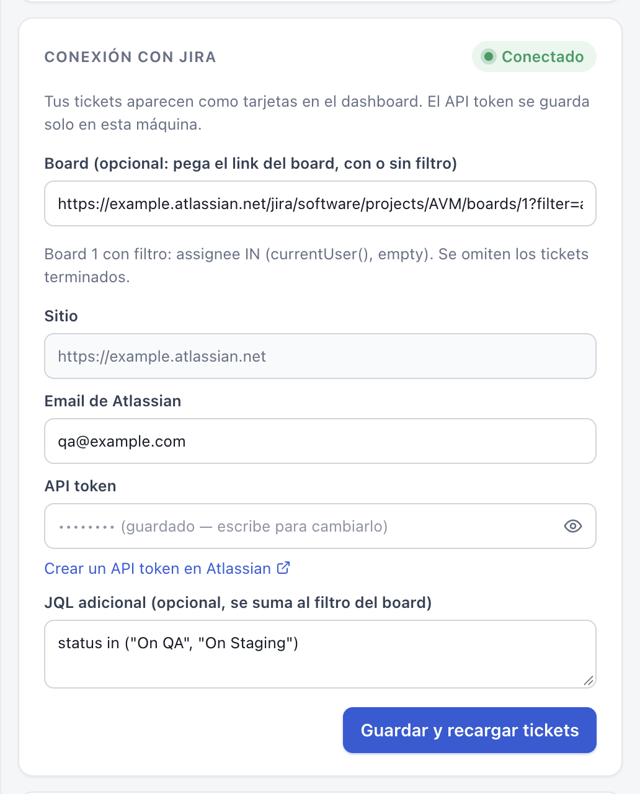

> **Tip: mostrar solo lo que te toca probar.** En **JQL adicional** escribe
> `status in ("On QA", "On Staging")`
> Los nombres de estado tienen que coincidir exactamente con los de tu Jira; si uno no existe, Jira devuelve un error que verás en la app. No uses `ORDER BY` en este campo.

Detalles a tener en cuenta:

- Con board, la app **omite los tickets terminados** (categoría *Done* de Jira) y trae hasta **100 tickets**.
- El token se guarda solo en tu equipo y nunca se muestra en la interfaz. Para cambiarlo, escribe uno nuevo; si dejas el campo vacío, se conserva el actual.
- Si el **Enlace de tickets** estaba vacío, al guardar se configura solo para que los tickets de tus registros abran Jira.

### 3.3 Estados de la conexión

El indicador aparece junto a **Tickets por probar** y en la tarjeta de ajustes:

| Estado | Significado |
| --- | --- |
| ⚪ **No conectado** | Falta el sitio, el email o el token. |
| 🟡 **Sin probar** | La conexión está configurada pero aún no se consultó Jira. |
| 🔵 **Conectando…** | La app está consultando Jira. |
| 🟢 **Conectado** | La última consulta funcionó. |
| 🔴 **Error de conexión** | La última consulta falló. El motivo aparece en pantalla. |

Si algo falla, la sección de tickets lo explica y ofrece **Reintentar** o **Revisar conexión**:

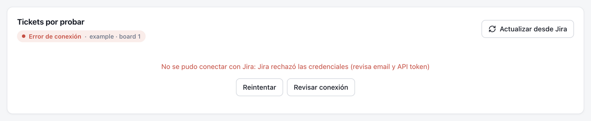

## 4. Registrar un test desde un ticket

Es el flujo del día a día. En el **Dashboard**, la sección **Tickets por probar** muestra tus tickets:

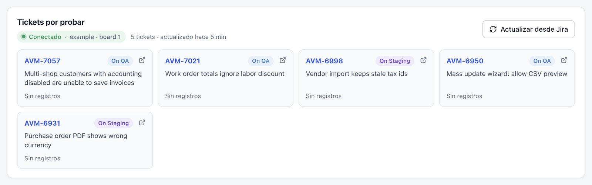

Cada tarjeta muestra:

- La **clave** del ticket (AVM-7057) y su **estado** en color: azul para On QA, violeta para On Staging.
- El **resumen** del ticket.
- Cuántos **registros** tienes de ese ticket (✓ 1 reg.) o «Sin registros».
- El icono ↗ para **abrir el ticket en Jira** (se abre en tu navegador).

Con 7 tickets o más aparece un buscador para filtrarlos. Para traer cambios de Jira, pulsa **Actualizar desde Jira** (o `⌘R`).

### Paso a paso

1. **Pulsa la tarjeta del ticket.** Se abre el formulario con el ticket, el título y el tipo **Funcional** ya cargados, y el cursor en **Casos passed**.
2. **Anota los casos**: passed, failed, blocked, bugs encontrados y minutos dedicados. Todos son opcionales.
3. **Revisa el resultado.** Se ajusta solo según los casos:
   - algún caso **failed** → **Failed**
   - algún caso **blocked** (y ningún failed) → **Blocked**
   - solo **passed** → **Passed**

   Si lo eliges a mano, tu elección se respeta. Usa **En progreso** para un test que aún no terminaste.
4. **Añade notas**: pasos, hallazgos, links a bugs…
5. **Guarda** con **Guardar registro** o `⌘↵`.

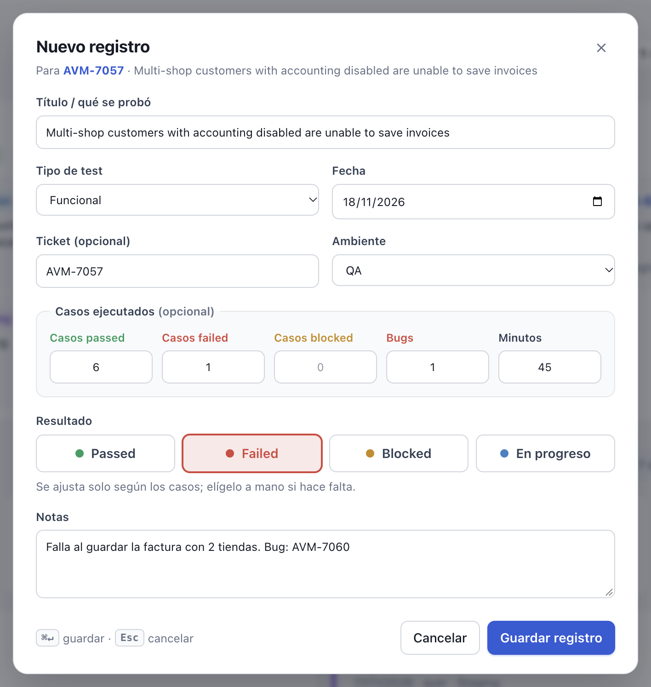

Al guardar aparece el aviso **Registro guardado** y la tarjeta del ticket suma el registro:

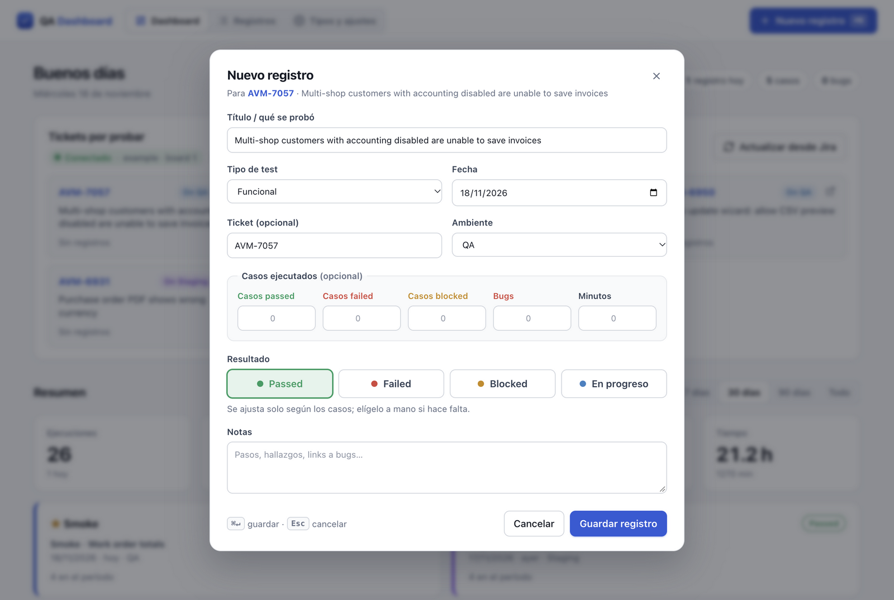

### Campos del formulario

| Campo | Para qué sirve |
| --- | --- |
| **Título / qué se probó** | Obligatorio. Desde un ticket se copia su resumen; puedes cambiarlo. |
| **Tipo de test** | Funcional, Smoke, Regression, Re-test… (se configuran en ajustes). |
| **Fecha** | Por defecto hoy. Cámbiala para registrar algo de otro día. |
| **Ticket (opcional)** | Clave de Jira. Se guarda en mayúsculas. |
| **Ambiente** | QA, STG, PROD… (se configuran en ajustes). |
| **Casos passed / failed / blocked** | Alimentan el pass rate y los gráficos. |
| **Bugs** | Bugs encontrados en esta ejecución. |
| **Minutos** | Tiempo dedicado; suma en el KPI **Tiempo**. |
| **Resultado** | Passed, Failed, Blocked o En progreso. |
| **Notas** | Texto libre. Se muestra bajo el título en la lista de registros. |

`Esc` o **Cancelar** cierran el formulario sin guardar.

### Validar un ticket con el orquestador QA

Los tickets en **On QA** u **On Staging** tienen debajo el botón **▷ Ejecutar orquestador QA**. Lanza el skill `/avm-qa-orchestrator` de Claude Code sobre ese ticket:

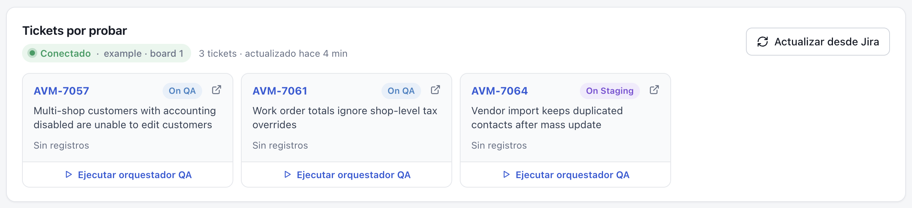

1. **Pulsa «Ejecutar orquestador QA»** en la tarjeta del ticket. El botón muestra «Abriendo Terminal…».
2. Se abre una **ventana nueva de Terminal** con Claude Code ejecutando, por ejemplo, `claude '/avm-qa-orchestrator AVM-7057'`. En la app aparece el aviso **Orquestador QA abierto en Terminal para AVM-7057**.
3. **Sigue el orquestador en Terminal.** Analiza el ticket, ejecuta los casos en qa.alpinevm.com, revisa el impacto y la regresión, y cierra con un veredicto **PASSED / PASSED W/F / FAILED / BLOCKED**.
4. **Aprueba cada paso que toca Jira.** El orquestador se asigna el ticket, publica el comentario de QA y puede crear TCs y bugs. Por eso corre en modo interactivo: tú decides en Terminal antes de cada cambio.
5. Cuando termine, **registra el resultado** en la app pulsando la tarjeta del ticket (pasos de arriba), para que cuente en tus KPIs.

Requisitos y límites:

- **Claude Code instalado** y con sesión iniciada (el comando `claude` debe funcionar en Terminal), con el skill `avm-qa-orchestrator` disponible.
- Solo funciona en **macOS**. En otros sistemas la app muestra el comando para que lo copies en tu terminal.
- El botón solo aparece en tickets **On QA** u **On Staging**. Si el ticket cambió de estado en Jira, pulsa **Actualizar desde Jira** primero; la app no lanza el orquestador para un ticket que ya no está en esos estados.
- Puedes lanzar el orquestador para varios tickets: cada uno se abre en su propia ventana de Terminal.

## 5. Registrar un test sin ticket (Smoke, Regression…)

Para suites grandes o tests que no dependen de un ticket:

1. Pulsa **Nuevo registro** (arriba a la derecha), `⌘N` o la tecla `N`.
2. Elige el **Tipo de test** (por ejemplo **★ Smoke**), escribe un título descriptivo y el **Ambiente**.
3. Anota los casos y guarda.

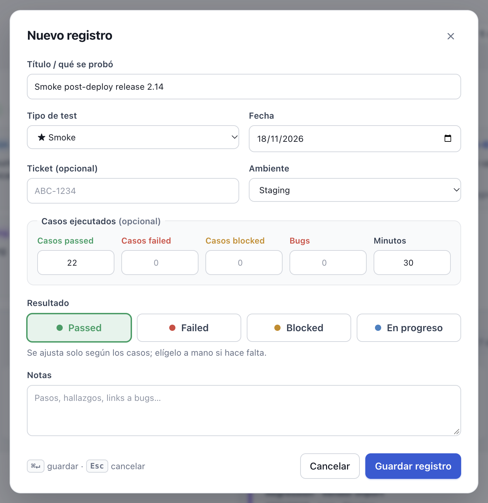

Los tipos marcados con ★ aparecen destacados en el dashboard con su última ejecución (sección 6).

### Ejecutar la regresión con Claude Code

La tarjeta **★ Regression** del dashboard tiene el botón **▷ Ejecutar regresión**. Lanza el skill `/avm-qa-skills:avm-regression-runner` de Claude Code, que ejecuta un test run de testomat.io contra staging:

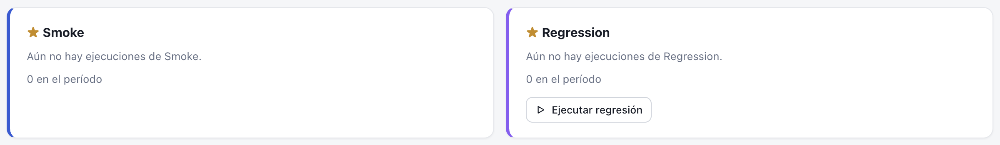

1. **Pulsa «Ejecutar regresión»** en la tarjeta Regression.
2. **Pega el test run de testomat.io**: el link del run o su ID, por ejemplo `#b333fb92`. Es opcional; si lo dejas vacío, el skill te lo pide en Terminal. Debajo ves el comando exacto que se va a ejecutar.
3. Pulsa **Abrir en Terminal**. Se abre una ventana nueva de Terminal con Claude Code y en la app aparece el aviso **Regresión abierta en Terminal**.
4. **Sigue la regresión en Terminal.** El skill valida cada TC en el navegador, marca los resultados en testomat.io, documenta los bugs, crea el epic en Jira con sus work items y cierra con un veredicto **GO / NO-GO**. Aprueba cada paso que publica en Jira o testomat.io.
5. Al terminar, **registra la ejecución** en la app: **Nuevo registro** → tipo **★ Regression**, ambiente **Staging** y los casos passed / failed / blocked del run.

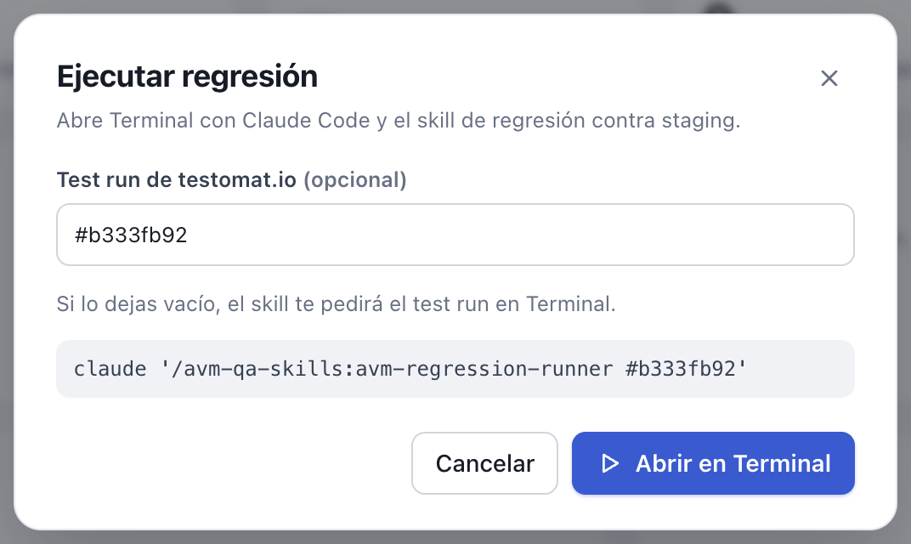

El botón aparece en cualquier tipo de test cuyo nombre contenga «Regres» y que esté marcado con ★. Los requisitos son los del orquestador (sección 4): macOS, Claude Code instalado y el skill disponible. La app solo acepta links de testomat.io o IDs de run, para que no se cuele otro comando en Terminal.

## 6. Leer el dashboard

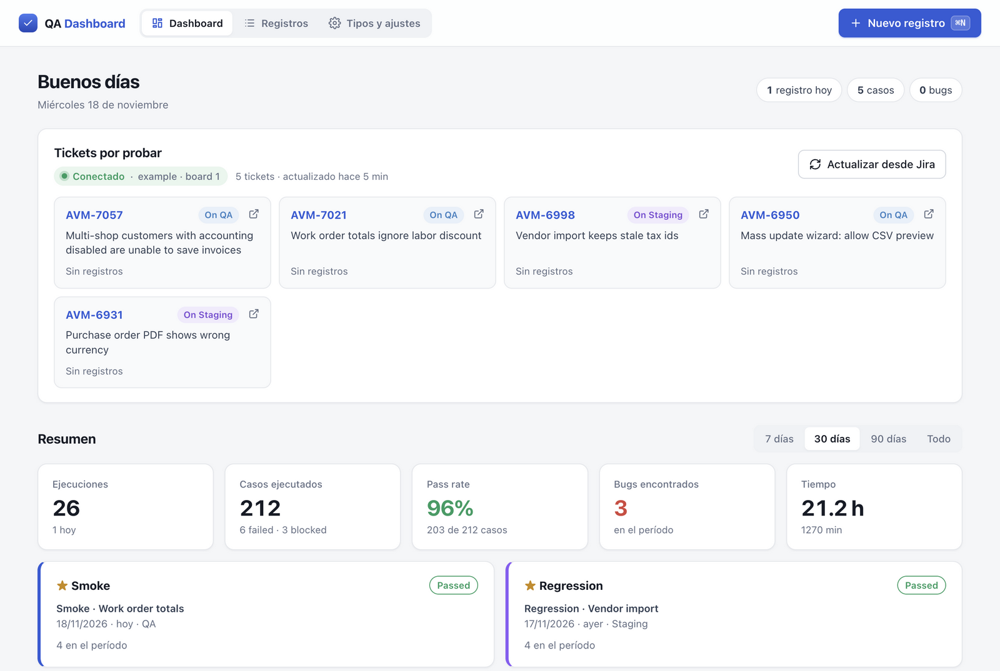

De arriba a abajo:

**Saludo y resumen de hoy.** Registros, casos y bugs que llevas hoy.

**Tickets por probar.** Ver sección 4.

**Resumen.** Elige el período arriba a la derecha: **7 días**, **30 días**, **90 días** o **Todo**.

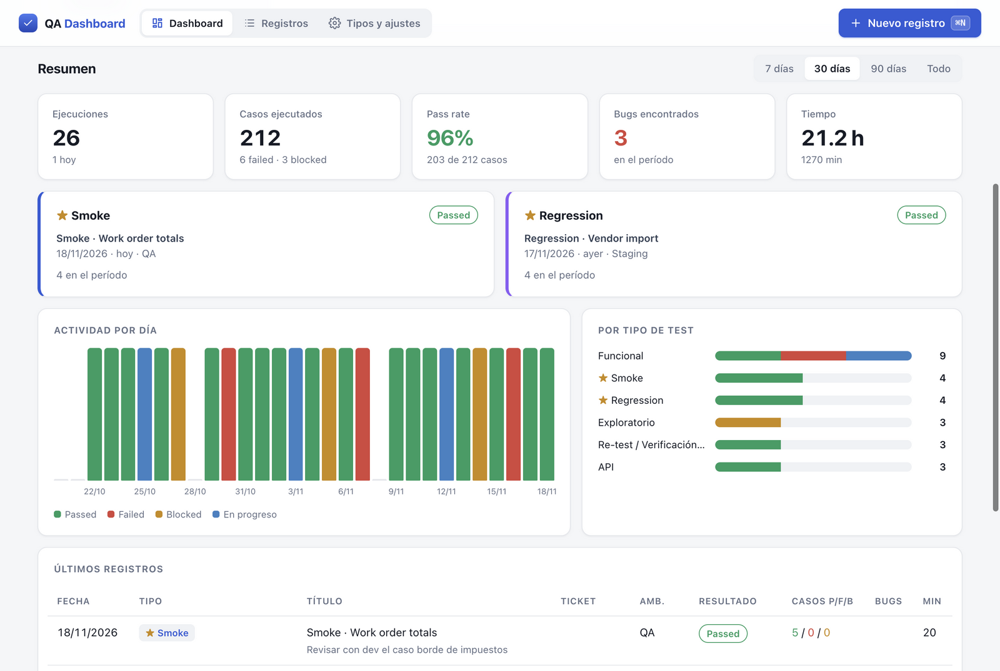

| KPI | Cómo se calcula |
| --- | --- |
| **Ejecuciones** | Número de registros del período (y cuántos son de hoy). |
| **Casos ejecutados** | Suma de casos passed + failed + blocked. |
| **Pass rate** | Casos passed ÷ casos ejecutados. Si ningún registro tiene casos, se calcula con registros: Passed ÷ registros terminados (sin contar «En progreso»). Verde desde 90 %, ámbar desde 70 %, rojo por debajo. |
| **Bugs encontrados** | Suma del campo Bugs. |
| **Tiempo** | Suma de minutos, en horas. |

Debajo de los KPIs:

- **Suites destacadas** (tipos con ★): resultado, título, fecha y ambiente de la **última** ejecución, y cuántas hubo en el período.
- **Actividad**: barras por día (7 y 30 días) o por semana (90 días y Todo), coloreadas por resultado. Pasa el ratón sobre una barra para ver el detalle.
- **Por tipo de test**: cuántas ejecuciones de cada tipo y con qué resultado.
- **Últimos registros**: los 8 más recientes.

## 7. Buscar, editar, duplicar y borrar registros

La vista **Registros** (`⌘2`) lista todo tu historial, del más reciente al más antiguo:

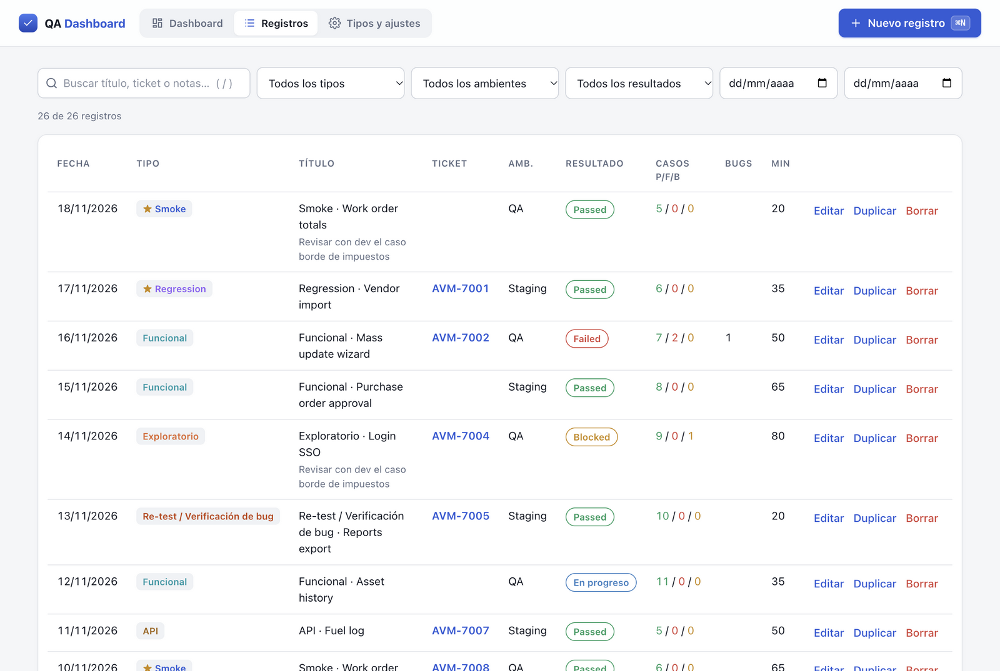

**Buscar y filtrar.** El buscador (`⌘F` o `/`) busca en título, ticket y notas. Puedes combinarlo con tipo, ambiente, resultado y un rango de fechas (desde / hasta). **Limpiar filtros** vuelve a mostrar todo.

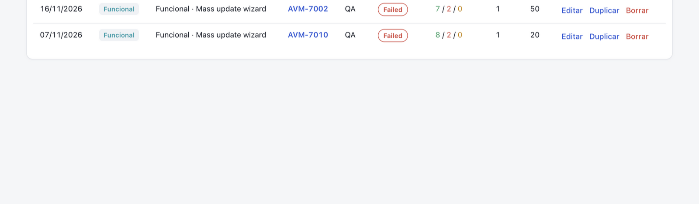

**Acciones de cada fila:**

- **Editar**: abre el formulario con los datos del registro.
- **Duplicar**: crea un registro nuevo con los mismos datos y la fecha de hoy. Es útil para repetir un test (por ejemplo, el re-test de un bug).
- **Borrar**: pide confirmación. El botón cambia a **¿Confirmar?** durante 3 segundos; púlsalo otra vez para borrar.

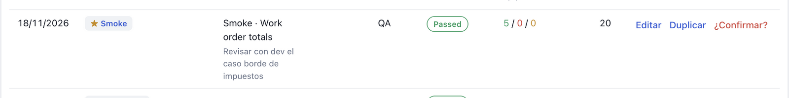

> El borrado no se puede deshacer. Si quieres una red de seguridad, exporta un respaldo de vez en cuando (sección 9).

Los tickets de la columna **Ticket** son enlaces: abren el ticket en Jira.

## 8. Personalizar tipos de test y ambientes

En **Tipos y ajustes** (`⌘3`):

**Tipos de test.**

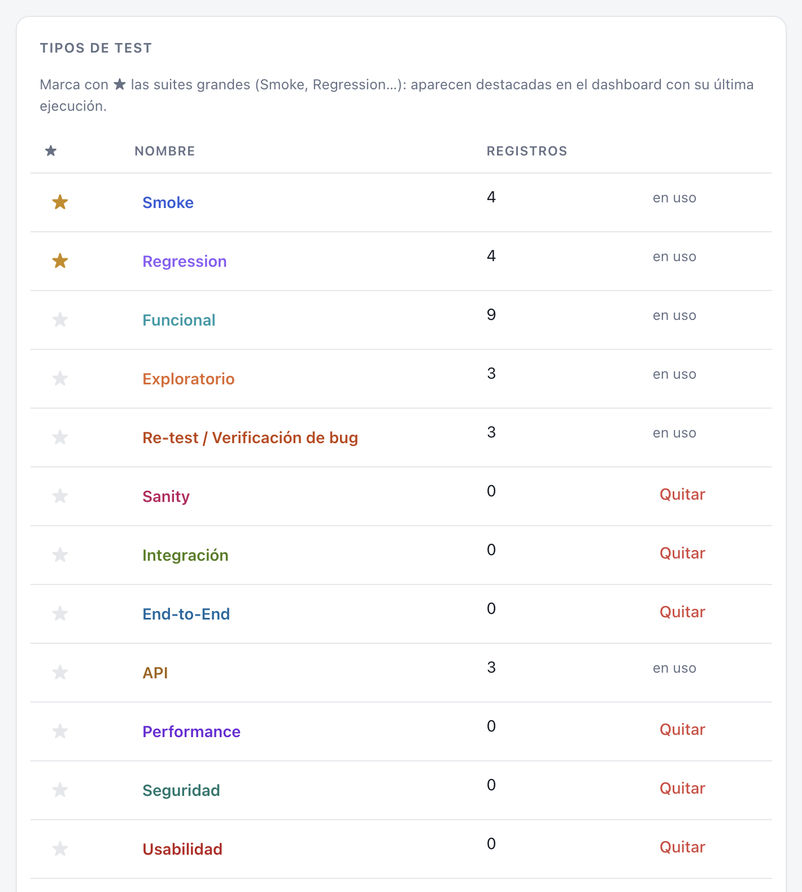

- Pulsa la **★** de un tipo para marcarlo como suite grande: aparecerá destacado en el dashboard.
- Haz clic en un **nombre** para renombrarlo; se guarda al salir del campo. Los registros existentes conservan el tipo con el nombre nuevo.
- **Quitar** solo aparece en tipos sin registros («en uso» indica que ya se usa). Siempre tiene que quedar al menos un tipo.
- Agrega tipos propios en el campo de abajo (por ejemplo «Migración de datos») y pulsa **Agregar** o `Enter`.

**Ambientes.**

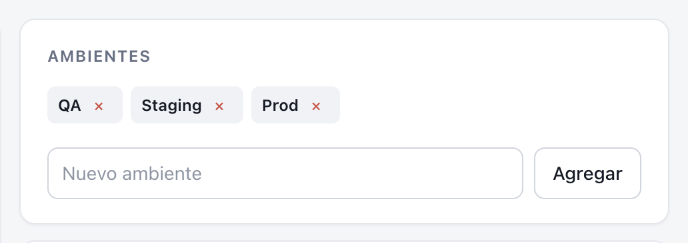

Agrega los ambientes en los que pruebas y quita los que no uses con la ×. Quitar un ambiente no modifica los registros que ya lo usan.

**Enlace de tickets.** La URL a la que se añade la clave del ticket para abrirlo (por ejemplo `https://tu-sitio.atlassian.net/browse/`). Se configura sola al conectar Jira.

## 9. Respaldo y exportación

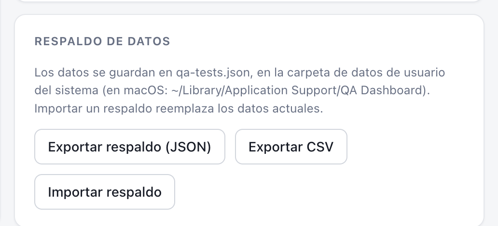

| Botón | Qué hace |
| --- | --- |
| **Exportar respaldo (JSON)** | Guarda un archivo (la app te pregunta dónde) con tus registros, tipos, ambientes y enlace de tickets. No incluye la conexión con Jira ni el token. |
| **Exportar CSV** | Guarda los registros en una tabla para abrir en Excel o Google Sheets. |
| **Importar respaldo** | Carga un respaldo JSON. **Reemplaza** los registros y ajustes actuales; exporta antes si tienes dudas. |

**Dónde se guardan los datos:** en `~/Library/Application Support/QA Dashboard/qa-tests.json` (macOS). El archivo solo lo puede leer tu usuario, porque contiene el API token de Jira. No lo compartas: para pasar tus registros a otra persona, usa **Exportar respaldo**.

## 10. Atajos de teclado

También están en los menús **Archivo** y **Ver** de la app.

| Atajo | Acción |
| --- | --- |
| `⌘N` o `N` | Nuevo registro |
| `⌘1` | Dashboard |
| `⌘2` | Registros |
| `⌘3` | Tipos y ajustes |
| `⌘F` o `/` | Buscar registros |
| `⌘R` | Actualizar tickets de Jira |
| `⌘↵` | Guardar el formulario |
| `Esc` | Cerrar el formulario sin guardar |
| `⌘+` / `⌘-` / `⌘0` | Acercar, alejar, tamaño real |

Las teclas sueltas (`N`, `/`) no actúan mientras escribes en un campo.

## 11. Solución de problemas

| Síntoma | Qué hacer |
| --- | --- |
| **«Jira rechazó las credenciales»** | Revisa el email y crea un token nuevo (los tokens caducan). Pégalo en **API token** y guarda. |
| **«Jira no encontró el board»** | Comprueba el link del board y que tu usuario tenga acceso a ese proyecto. |
| **«The value 'X' does not exist for the field 'status'»** | Un estado del JQL adicional no existe con ese nombre exacto (cuidado con mayúsculas y tildes). Corrígelo, por ejemplo «On Staging» y no «On Stagging». |
| **Conectado, pero «no hay tickets pendientes»** | Ningún ticket abierto cumple el filtro del board + JQL. Prueba a vaciar el JQL adicional para comprobarlo. |
| **Falta un ticket que esperaba** | La app omite los tickets terminados y trae como máximo 100. Ajusta el filtro para acotar. |
| **Los tickets no reflejan cambios recientes** | Pulsa **Actualizar desde Jira** (`⌘R`); la app no se actualiza sola. |
| **«El puerto 8765 está ocupado»** al abrir | Otro programa usa ese puerto. Ciérralo, o abre la app desde la Terminal con otro puerto: `QA_DASH_PORT=8770 "/Applications/QA Dashboard.app/Contents/MacOS/QA Dashboard"`. |
| **Terminal dice `command not found: claude`** | Instala Claude Code o añade `~/.local/bin` a tu PATH, y vuelve a pulsar **Ejecutar orquestador QA**. |
| **«No se pudo abrir Terminal»** | Al primer uso macOS pide permiso para que QA Dashboard controle Terminal. Concédelo en **Ajustes del Sistema → Privacidad y seguridad → Automatización**. |
| **macOS dice que la app no se puede abrir** | La primera vez ábrela con **clic derecho → Abrir**. |
| **La app se ve muy grande o muy pequeña** | `⌘0` vuelve al tamaño real; `⌘+` / `⌘-` ajustan el zoom. |
