# QA Dashboard user guide

QA Dashboard is a desktop app to log the tests you do every day (functional, exploratory, re-tests…) and large suites (Smoke, Regression). It loads your Jira tickets so you can log a test in one click, and it shows metrics about your work: runs, cases, pass rate, bugs and time.

Everything runs on your computer: there is no cloud server and your data does not leave your machine, except for the queries the app makes to your own Jira.

The UI can be switched between English and Spanish (see [Language: English or Spanish](#language-english-or-spanish)). This guide uses the English labels.

> The screenshots in this guide use sample data (`example.atlassian.net`) and show the Spanish UI. Your screen will show your own tickets and runs.

## Contents

1. [Open the app](#1-open-the-app)
   - [Try the demo](#try-the-demo)
2. [First launch](#2-first-launch)
3. [Connect Jira](#3-connect-jira)
4. [Log a test from a ticket](#4-log-a-test-from-a-ticket)
   - [Validate a ticket with the QA orchestrator](#validate-a-ticket-with-the-qa-orchestrator)
5. [Log a test without a ticket (Smoke, Regression…)](#5-log-a-test-without-a-ticket-smoke-regression)
   - [Run the smoke test with Claude Code](#run-the-smoke-test-with-claude-code)
   - [Run the regression with Claude Code](#run-the-regression-with-claude-code)
   - [Automated QA runs in Runs and on the dashboard](#automated-qa-runs-in-runs-and-on-the-dashboard)
   - [Claude assistant](#claude-assistant)
6. [Read the dashboard](#6-read-the-dashboard)
7. [Search, edit, duplicate and delete runs](#7-search-edit-duplicate-and-delete-runs)
8. [Customize test types and environments](#8-customize-test-types-and-environments)
9. [Backup and export](#9-backup-and-export)
10. [Keyboard shortcuts](#10-keyboard-shortcuts)
11. [Troubleshooting](#11-troubleshooting)

---

## 1. Open the app

**If someone gave you `QA Dashboard.app`:**

1. Drag `QA Dashboard.app` to the **Applications** folder.
2. The first time, **right-click → Open** and confirm with **Open**. macOS asks for this because the app is not signed; after that, a double-click is enough.
3. To keep it at hand: with the app open, right-click its Dock icon → **Options → Keep in Dock**.

**If you have the project code** (you need Node.js 20 or later):

```bash
npm install            # first time only
npm run desktop        # opens the desktop app
npm run desktop:pack   # generates release/mac-*/QA Dashboard.app
```

The window remembers its size and position, so it opens where you left it.

### Try the demo

The demo opens the app with sample data (5 tickets, about 30 runs from the last month and 4 Claude runs with their reports), so you can learn it or present it without touching your data:

- In the app: **Help → Open demo (sample data)** menu. It opens in a separate window.
- From the code: `npm run demo` (or `npm run demo:en` to start in English), at `http://127.0.0.1:8790`.

The header shows the **DEMO** badge. Jira, Claude and translation are simulated: a smoke, regression or orchestrator launched in the demo runs for about 40 seconds with its **Running** indicator, its live activity and its report, and posting to Jira posts nothing. Every time it opens, the demo starts with the same data. To present it to the team, follow the [demo script](DEMO.md).

## 2. First launch

The first time, you see an empty **Dashboard** with a **Get started in two steps** guide:

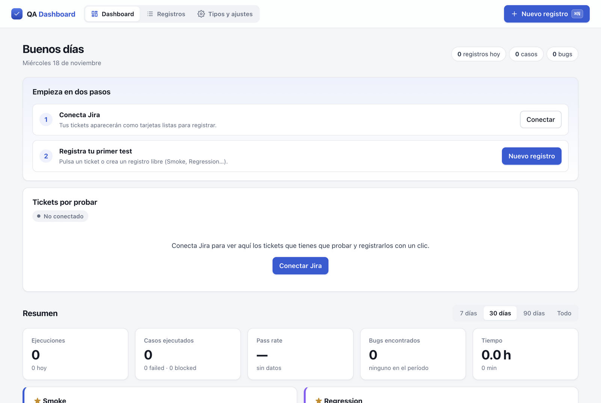

1. **Connect Jira**: to see your tickets as cards (section 3). It is optional, but it is what saves the most time.
2. **Log your first test**: with **New run** or by clicking a ticket.

The guide disappears as soon as you save your first run.

At the top you always have the three views of the app (**Dashboard**, **Runs** and **Types & settings**) and the **New run** button.

## 3. Connect Jira

### 3.1 Create an Atlassian API token

The app connects to Jira with your email and an API token (not your password).

1. Open <https://id.atlassian.com/manage-profile/security/api-tokens> (the app also has a **Create an API token in Atlassian** link).
2. Click **Create API token**, give it a name (for example "QA Dashboard") and choose the expiration.
3. Copy the token. Atlassian shows it only once.

### 3.2 Complete the connection

Go to **Types & settings** (or click **Connect Jira** on the dashboard) and find the **Jira connection** card:

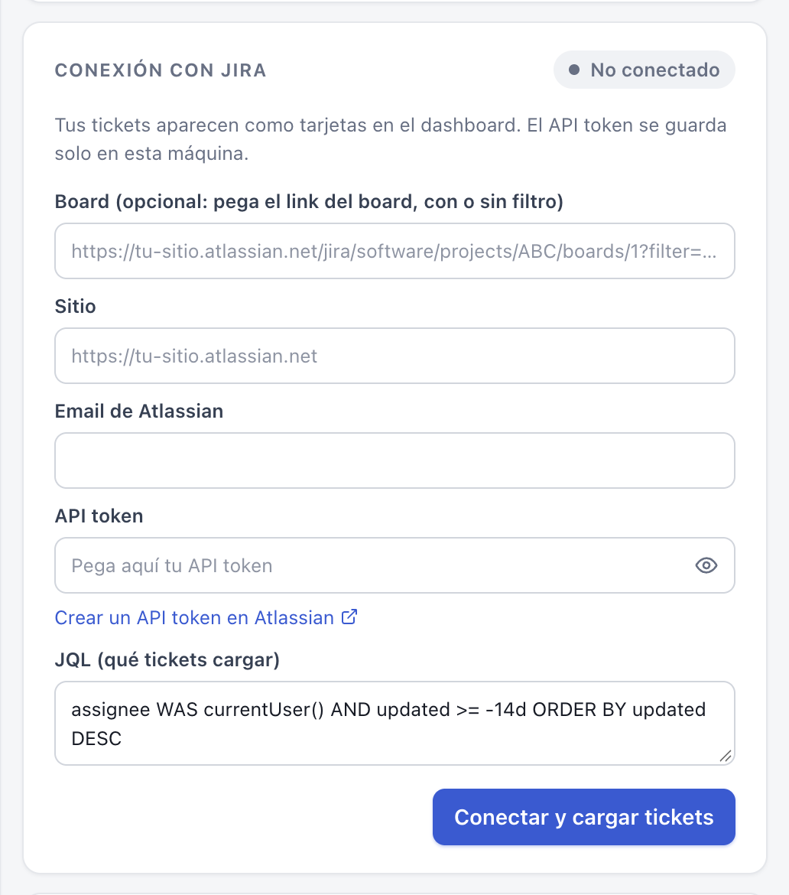

| Field | What to enter |
| --- | --- |
| **Board** | The link to your Jira board, copied as is from the browser. If the board has a people filter (`?filter=assignee+IN+(...)`), it is used too. It is optional: without a board, the app uses the JQL. |
| **Site** | Filled in automatically when you paste the board (`https://your-site.atlassian.net`). Without a board, type it by hand. |
| **Atlassian email** | The email you sign in to Jira with. |
| **API token** | The token from the previous step. The eye icon shows or hides it. |
| **Extra JQL** | With a board: an optional extra filter (see below). Without a board: the full query. |

Click **Connect and load tickets**. If everything works, the indicator changes to **Connected** and the "Jira connected" notice appears.

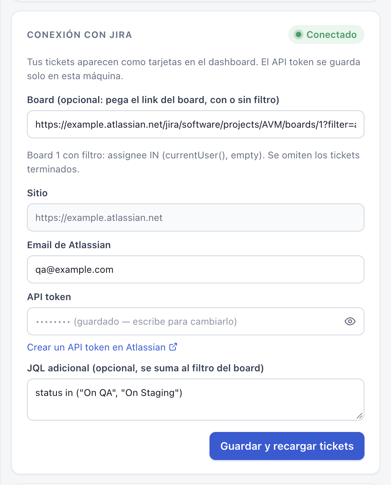

> **Tip: show only what you need to test.** In **Extra JQL**, enter
> `status in ("On QA", "On Staging")`
> Status names must match the ones in your Jira exactly; if one does not exist, Jira returns an error that you will see in the app. Do not use `ORDER BY` in this field.

Things to keep in mind:

- With a board, the app **leaves out done tickets** (Jira's *Done* category) and loads up to **100 tickets**.
- The token is stored only on your computer and is never shown in the UI. To change it, type a new one; if you leave the field empty, the current one is kept.
- If **Ticket links** was empty, it is set automatically on save so the tickets in your runs open Jira.

### 3.3 Connection states

The indicator appears next to **Tickets to test** and on the settings card:

| State | Meaning |
| --- | --- |
| ⚪ **Not connected** | The site, email or token is missing. |
| 🟡 **Not tested** | The connection is set up but Jira has not been queried yet. |
| 🔵 **Connecting…** | The app is querying Jira. |
| 🟢 **Connected** | The last query worked. |
| 🔴 **Connection error** | The last query failed. The reason is shown on screen. |

If something fails, the tickets section explains it and offers **Retry** or **Check connection**:

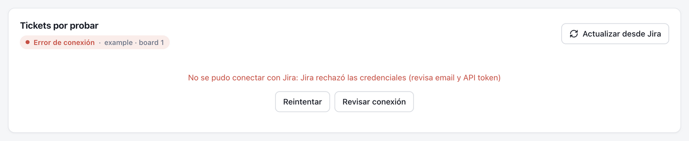

## 4. Log a test from a ticket

This is the everyday flow. On the **Dashboard**, the **Tickets to test** section shows your tickets:

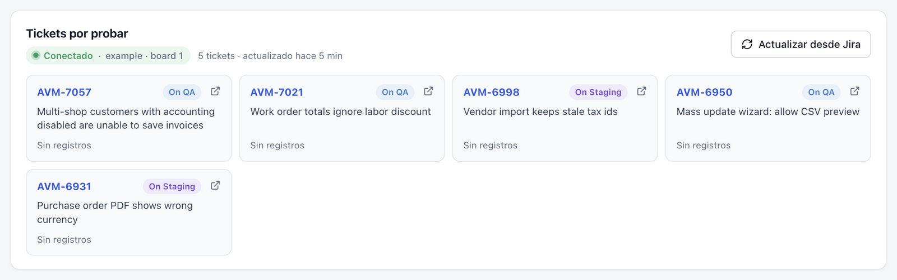

Each card shows:

- The ticket **key** (AVM-7057) and its colored **status**: blue for On QA, purple for On Staging.
- The ticket **summary**.
- How many **runs** you have for that ticket (✓ 1 run) or "No runs".
- The ↗ icon to **open the ticket in Jira** (it opens in your browser).

With 7 or more tickets, a search box appears to filter them.

**Tickets refresh on their own** while the app is open: every 5 minutes and every time you return to the window (if the last load is more than a minute old). When a new ticket lands in **On QA** or **On Staging**, the app tells you with "New ticket in On QA: AVM-…", also as a system notification in the desktop app. To get the changes right away, click **Refresh from Jira** (or `⌘R`).

### Step by step

1. **Click the ticket card.** The form opens with the ticket, the title and the **Functional** type already filled in, and the cursor in **Cases passed**.
2. **Enter the cases**: passed, failed, blocked, bugs found and minutes spent. All of them are optional.
3. **Check the result.** It is set automatically from the cases:
   - any **failed** case → **Failed**
   - any **blocked** case (and no failed) → **Blocked**
   - only **passed** → **Passed**

   If you pick it by hand, your choice is kept. Use **In progress** for a test you have not finished yet.
4. **Add notes**: steps, findings, bug links…
5. **Save** with **Save run** or `⌘↵`.

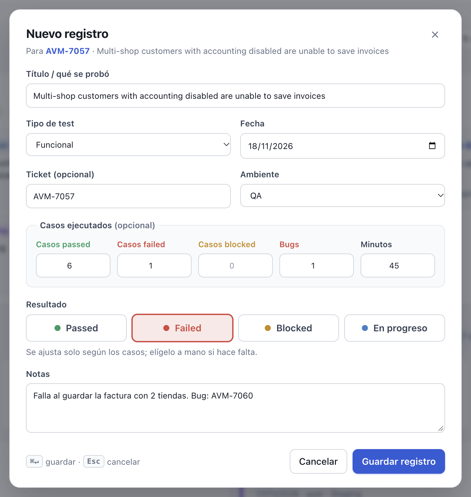

When you save, the **Run saved** notice appears and the ticket card adds the run:

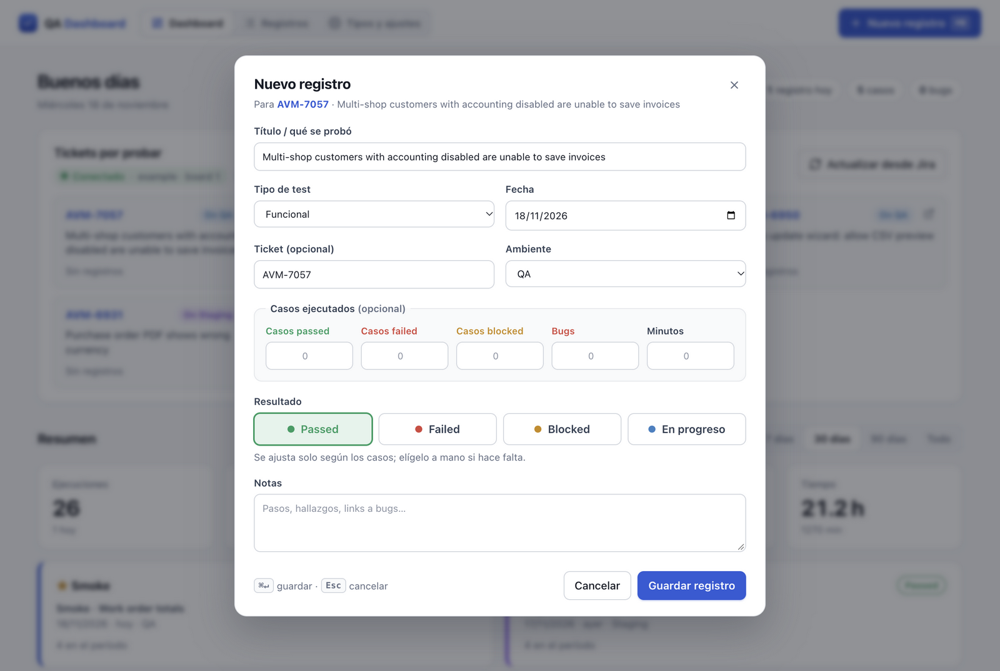

### Form fields

| Field | What it is for |
| --- | --- |
| **Title / what was tested** | Required. From a ticket, its summary is copied; you can change it. |
| **Test type** | Functional, Smoke, Regression, Re-test… (configured in settings). |
| **Date** | Today by default. Change it to log something from another day. |
| **Ticket (optional)** | Jira key. Saved in uppercase. |
| **Environment** | QA, STG, PROD… (configured in settings). |
| **Cases passed / failed / blocked** | Feed the pass rate and the charts. |
| **Bugs** | Bugs found in this run. |
| **Minutes** | Time spent; added to the **Time** KPI. |
| **Result** | Passed, Failed, Blocked or In progress. |
| **Notes** | Free text. Shown under the title in the runs list. |

`Esc` or **Cancel** closes the form without saving.

### Language: English or Spanish

The app works in English or Spanish. Change the language with the **EN / ES** selector in the header or in **Types & settings → Language**. The change applies to the whole UI, dates, error messages, the desktop app menu and the exported CSV. These are translated too:

- **What the app writes**: the titles and notes of the runs it creates for Claude runs (for example "Smoke STG with Claude · GO") and the default test types you have not renamed (for example "Functional"). A run you edited by hand keeps your text.
- **What Claude writes**: new runs are written in the app language. Earlier ones are translated in the background with Claude (Haiku model) when you change the language, once per report; meanwhile, the report shows the original with the notice "Translating the report…". The Jira comment is not translated.

Test types you renamed and environments are not translated: they are your data. The live activity and the log show what Claude wrote, as is.

### Validate a ticket with the QA orchestrator

> **Claude runs execute on their own, in the background.** The orchestrator, the smoke test and the regression do not open Terminal or ask you anything: the app starts Claude Code with no window (`claude -p --chrome --permission-mode auto`) in the `~/qa-dashboard-runs` folder. `auto` mode approves only safe steps, and Claude decides using each skill's criteria, including what to post to Jira and testomat.io. It records its decisions in the report notes.
>
> **Before launching a run**, have Chrome open with the **Claude in Chrome** extension connected and be signed in to the site that will be tested. Without a browser, the run ends as **BLOCKED**.

Tickets in **On QA** or **On Staging** have the **▷ Run QA orchestrator** button below them. It launches the Claude Code `/avm-qa-orchestrator` skill on that ticket:

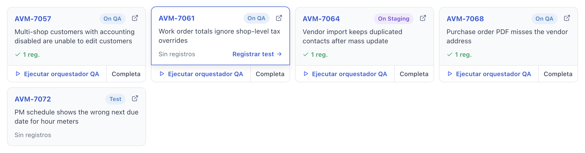

1. **Click "Run QA orchestrator"** on the ticket card. The app shows the notice **QA orchestrator running in the background for AVM-7057**.
2. **The ticket card changes to "Running · validating · N min"** and the header shows **Running**. Click either one to see the progress live (see [Follow a run in progress](#follow-a-run-in-progress)).
3. The orchestrator analyzes the ticket, runs the cases on qa.alpinevm.com, reviews impact and regression, assigns the ticket to itself, posts the QA comment, and may create TCs and bugs. It ends with a **PASSED / PASSED W/F / FAILED / BLOCKED** verdict.
4. **The result is logged in Runs automatically**: when you launch it, an "In progress" run for the ticket appears and, when the orchestrator finishes, it is completed with its verdict (see [Automated QA runs](#automated-qa-runs-in-runs-and-on-the-dashboard)).

Requirements and limits:

- **Claude Code installed** and signed in, with the `avm-qa-orchestrator` skill available. The app looks for the `claude` command in `~/.local/bin`, `/opt/homebrew/bin` and `/usr/local/bin`.
- The button appears only on **On QA** or **On Staging** tickets. If the ticket changed status in Jira, click **Refresh from Jira** first; the app does not launch the orchestrator for a ticket that is no longer in those statuses.
- You can launch the orchestrator for several tickets at once: each one runs in its own process.

## 5. Log a test without a ticket (Smoke, Regression…)

For large suites or tests that do not depend on a ticket:

1. Click **New run** (top right), `⌘N` or the `N` key.
2. Choose the **Test type** (for example **★ Smoke**), enter a descriptive title and the **Environment**.
3. Enter the cases and save.

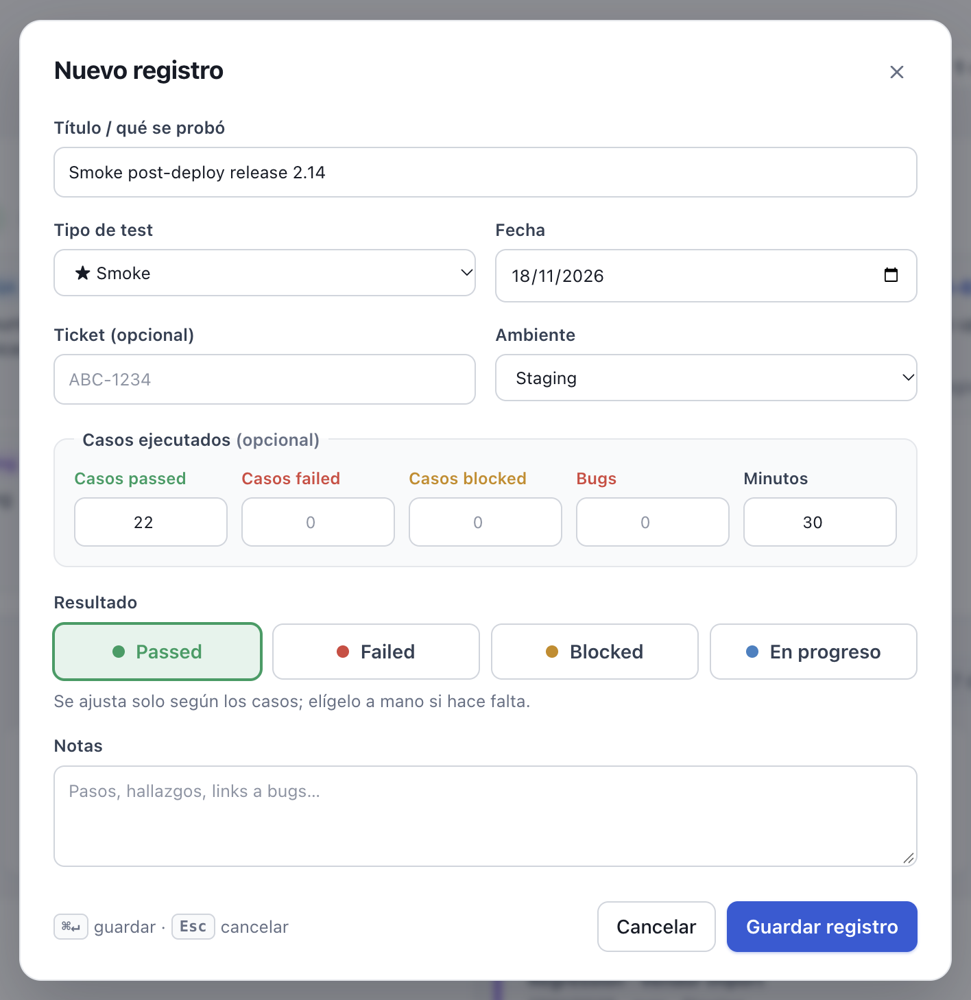

Types marked with ★ are highlighted on the dashboard with their latest run (section 6).

### Run the smoke test with Claude Code

The dashboard's **★ Smoke** card has two buttons, one per site: **▷ Smoke on QA** (qa.alpinevm.com) and **▷ Smoke on STG** (staging.alpinevm.com). Both launch the Claude Code `/avm-qa-skills:avm-smoke-tester` skill, the quick post-deploy smoke test:

1. **Click the button for the site you want to test.** No other input is needed. The app shows the notice **Smoke on QA running in the background** and the button changes to **Running · QA · N min**.
2. The smoke test walks the happy path of login, navigation, Work Orders, Reports, the Mass Upload/Update wizards, Purchase Orders, Vendors/Customers and Admin, without creating data. It ends with a **GO / NO-GO** verdict and a markdown summary; you decide where to post it.
3. When it finishes, **Claude reports the result to the app** and the smoke test is logged automatically (see [Automated QA runs in Runs and on the dashboard](#automated-qa-runs-in-runs-and-on-the-dashboard)).

If you need both sites, click both buttons: each smoke test runs separately. The buttons appear on any test type whose name contains "Smoke" and that is marked with ★. The sites are configured in **Types & settings → Sites & skills** (section 8).

### Run the regression with Claude Code

The dashboard's **★ Regression** card has the **▷ Run regression** button. It launches the Claude Code `/avm-qa-skills:avm-regression-runner` skill, which executes a testomat.io test run against staging:

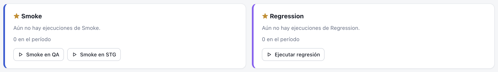

1. **Click "Run regression"** on the Regression card.
2. **Paste the testomat.io test run**: the run link or its ID, for example `#b333fb92`. It is optional; if you leave it empty, the skill picks the right test run or reports **BLOCKED** if it cannot. Below, you see the exact prompt Claude will receive.
3. Click **Run**. The app shows the notice **Regression running in the background** and the card button changes to **Running**.
4. The skill validates each TC in the browser, marks the results in testomat.io, documents the bugs, creates the Jira epic with its work items and ends with a **GO / NO-GO** verdict.
5. When it finishes, **Claude reports the result to the app** and the regression is logged automatically (see below).

> **Test mode.** Check **Test mode: read-only in Jira and testomat.io** in the dialog to try a regression without leaving anything behind: Claude validates the test cases in the browser as usual, but does not create the epic, suite tasks, bugs or summary comment in Jira, and does not mark results in testomat.io. The run is titled **Regression … (test mode)**, its report says so, lists the bugs without Jira keys and notes what it would have created; the app never offers a Jira comment for it.

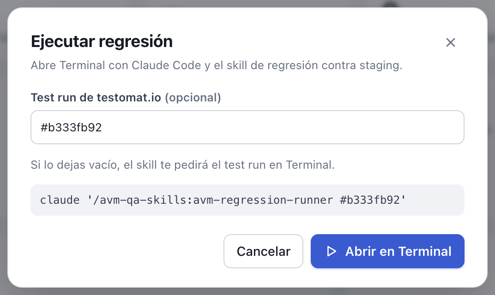

The button appears on any test type whose name contains "Regres" and that is marked with ★. The requirements are the same as for the orchestrator (section 4): Claude Code installed and the skill available. The app only accepts testomat.io links or run IDs (the accepted domains are configured in **Sites & skills**).

### Automated QA runs in Runs and on the dashboard

**Every run you launch from the app is logged**: the QA orchestrator for a ticket, the smoke test on QA or STG, and the regression.

1. **When you launch it**, the app immediately creates an **In progress** run in **Runs** (for example "Smoke STG with Claude · running"), with its type, environment and, for the orchestrator, the ticket.
2. **When it finishes**, Claude reports the result to the app and **that same run is completed** with the verdict in the title, the result, the cases, the bugs, the minutes, and notes with the summary and the link.

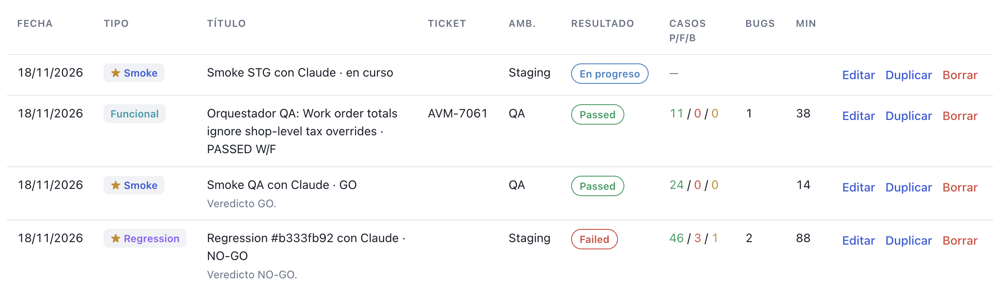

How the verdict maps to the run result:

| Run | Test type | Verdict → Result |
| --- | --- | --- |
| Smoke on QA / STG | ★ Smoke | GO → **Passed** · NO-GO → **Failed** · BLOCKED → **Blocked** |
| Regression | ★ Regression | GO → **Passed** · NO-GO → **Failed** · BLOCKED → **Blocked** |
| QA orchestrator | Functional (with the ticket) | PASSED and PASSED W/F → **Passed** · FAILED → **Failed** · BLOCKED → **Blocked** |

The dashboard also shows them in the **Automated QA runs** section:

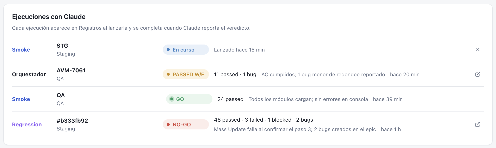

- **Running**: Claude is still working in the background. The app checks every 10 seconds whether there is a result, without you having to reload.
- **With a verdict** (GO, NO-GO, BLOCKED, PASSED, PASSED W/F, FAILED): Claude finished and reported the cases, the bugs, a short summary and, if there is one, the link to the report, epic or comment (↗ icon). The app notifies you with, for example, "Smoke STG: GO" and, in the desktop app, with a system notification.
- **No result**: more than 12 hours passed without a report. Click the **×** to stop and dismiss it: its "In progress" run is removed too.

If Claude finishes without sending the result (for example, because it failed or was cut off), the app closes the run as **BLOCKED** with its last message, so it never stays "running". A run that goes over 4 hours stops on its own.

#### Follow a run in progress

While a run is in progress, the dashboard shows it in several places:

- In the **header**, next to the language selector: **Running · Smoke STG · 6 min**, or **2 runs in progress** if there are several.
- On the **Smoke or Regression card**: the **Running** label and the site button showing **Running · STG · 6 min**.
- On the **ticket card** the orchestrator is validating: **Running · validating · 3 min**.
- In **Automated QA runs**: **Running** and the minutes it has been running in the background.

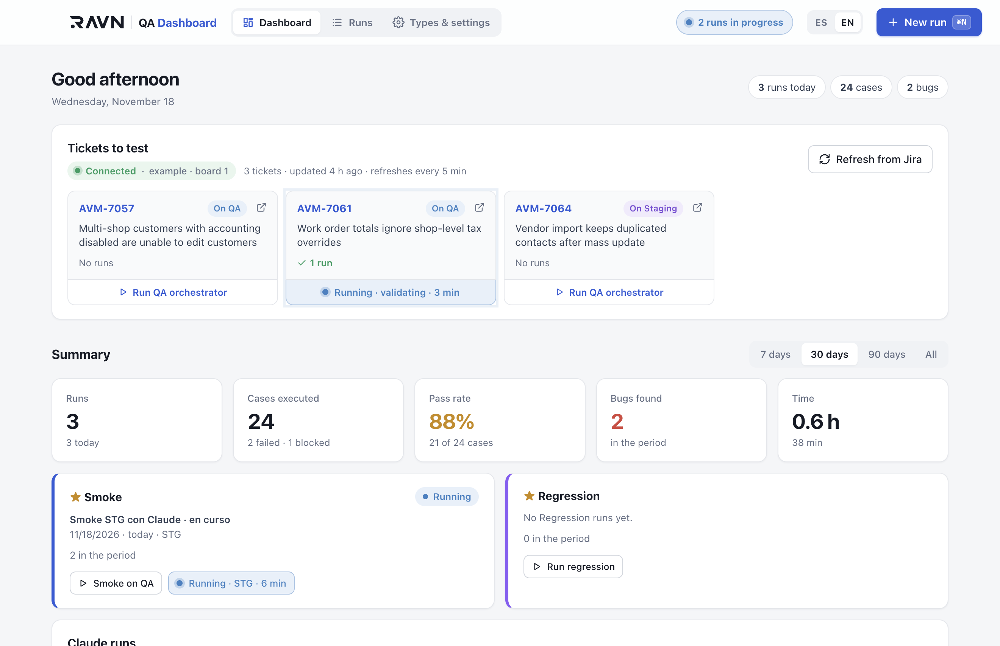

Click any of those indicators to open the run. You see the **Live activity**: what Claude says and each browser action, for example `Chrome · navigate: https://staging.alpinevm.com`. It refreshes every 4 seconds. The **Stop** button (asks for confirmation) ends the process and leaves the run as **BLOCKED**.

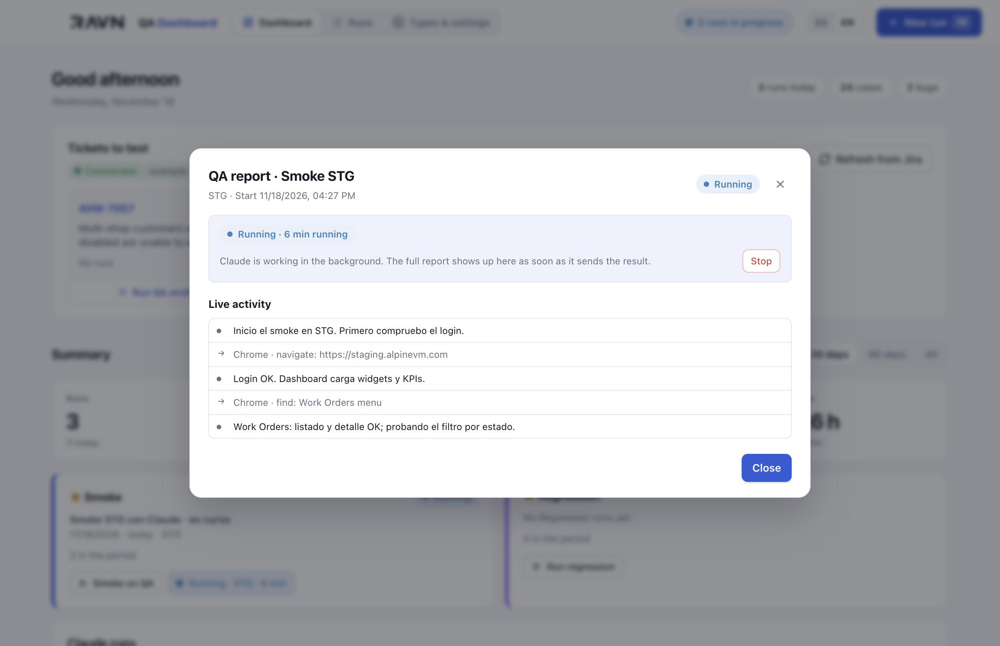

#### QA report of a run

**Click a run** in **Automated QA runs** (or the eye icon), or **Report** next to its row in **Runs**, to open its full QA report:

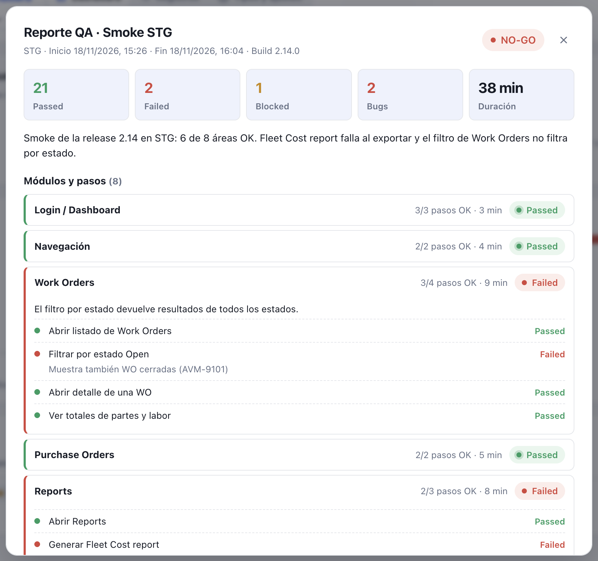

- **Header**: verdict, environment, start and end time, and the build tested if Claude saw it.
- **Totals**: passed, failed and blocked cases, bugs found and duration.
- **Modules and steps**: each tested area (Login, Work Orders, Reports…) with its status, the OK steps out of the total, and its minutes. Modules with failures or blocks open on their own and show each step with its status and a note on what happened; the ones that passed expand with a click.
- **Bugs found**: Jira key, title, severity and module, with a link to each bug. Once the run has finished, **Edit** lets you fix them: add the Jira key of a bug you filed later (with only the key, the link is built from your Jira site), correct a title, severity or module, and add or remove bugs. The change is saved in every language of the report, and the run's bug count follows the list. A bug that another report also lists with the same Jira key (for example, found on QA and again on STG) shows **Also in Smoke QA · 11/19**, and the dashboard's **Bugs found** counts it once.
- **Notes**: what was left untested and why, risks and notes from Claude.
- **QA comment for Jira**: the comment the skill wrote for the ticket. If Claude could not post it (for example, because the Jira tool asks for approval and nobody can give it in the background), review it, edit it if needed, and click **Post on AVM-…** (asks for confirmation). The app posts it with your Jira email and API token, the same ones used for the ticket list, and adds a **View on Jira** link. **Copy** copies it to the clipboard. If you already posted another comment on the ticket (for example, after finishing by hand what was blocked), click **Already posted / Dismiss** (asks for confirmation) so the app does not post it; **Restore** makes it pending again.

Runs from before this version only include the summary; the report says so.

How the result arrives: when it launches the skill, the app adds a final instruction to the prompt so that Claude, when it finishes, sends the result with a POST to `http://127.0.0.1:8765/api/automation/<id>/result`. Claude runs in the background and makes that call without asking for permission.

**BLOCKED** means Claude could not test (for example, without the Claude in Chrome extension connected or without access to the site). It is not a build failure: connect what is missing and launch the run again.

Since they are normal runs, they count in the KPIs and charts, and the latest smoke test and the latest regression appear on their cards:

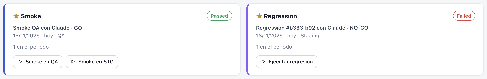

If Claude never reports, you can complete the "In progress" run by hand with **Edit** in **Runs**.

### Claude assistant

Click **Assistant** in the header (or `⌘K`, also under **View → Claude assistant**) to open a chat with Claude that knows your QA data: your recent runs, the Jira tickets and the reports of the Claude runs.

- **Ask it** about your data: "What failed this week?", "Summarize the latest report", "Which tickets do I still need to test?". It answers with dates, keys and numbers from the app; if a piece of data is not there, it says so.
- **Ask it to do things**: launch the smoke test or the regression, run the orchestrator on a ticket, create a run, post the pending comment to Jira, or open a report. **It never does anything on its own**: each action appears as a card and runs only when you click **Confirm** (or **Dismiss** to skip it). Actions use the same buttons as the app, so the same rules apply (for example, the same thing is not launched twice).

It uses Claude Code with your session, like the runs: no API key needed. Each answer takes a few seconds. Claude has no tools in the assistant (it does not run commands or open files); it only answers with what the app passes to it, and it never receives your Jira API token or email. The conversation is kept while the app is open; the panel's reload icon (**New conversation**) starts a new one.

## 6. Read the dashboard

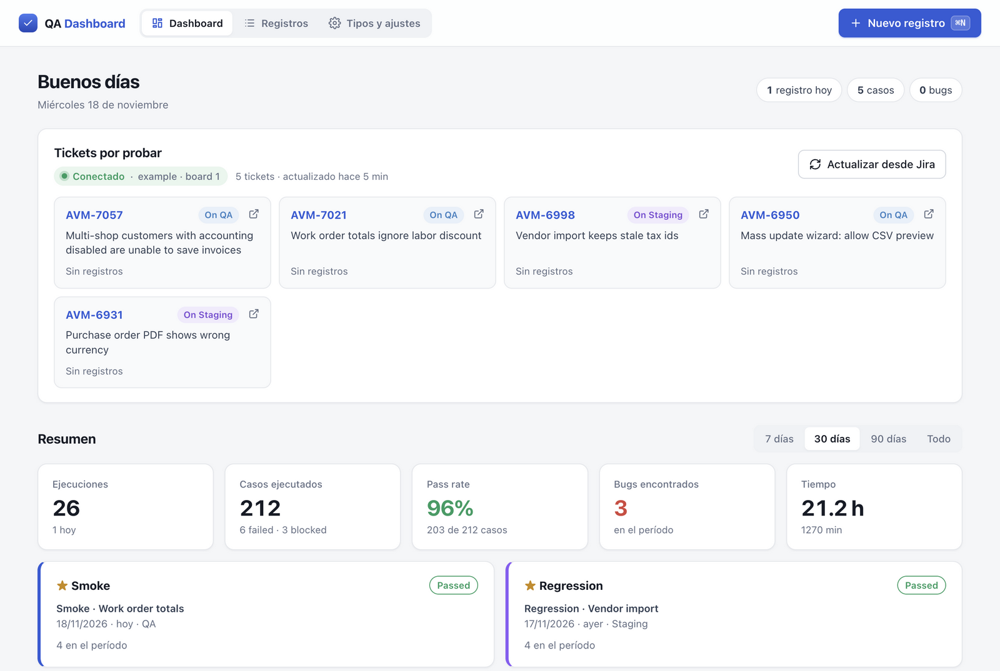

From top to bottom:

**Greeting and today's summary.** The runs, cases and bugs you have logged today.

**Tickets to test.** See section 4.

**Summary.** Choose the period at the top right: **7 days**, **30 days**, **90 days** or **All**.

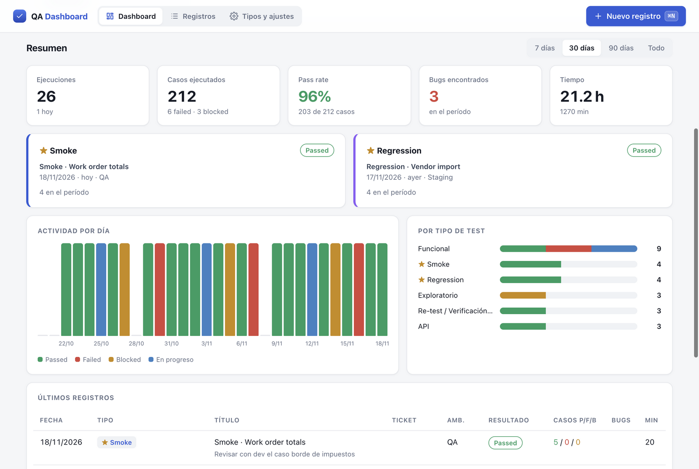

| KPI | How it is calculated |
| --- | --- |
| **Runs** | Number of runs in the period (and how many are from today). |
| **Cases executed** | Sum of passed + failed + blocked cases. |
| **Pass rate** | Passed cases ÷ executed cases. If no run has cases, it is calculated with runs: Passed ÷ finished runs (not counting "In progress"). Green from 90%, amber from 70%, red below. |
| **Bugs found** | Sum of the Bugs field; a bug that several reports list with the same Jira key counts once. |
| **Time** | Sum of minutes, in hours. |

Below the KPIs:

- **Highlighted suites** (types with ★): result, title, date and environment of the **latest** run, and how many there were in the period.
- **Activity**: bars per day (7 and 30 days) or per week (90 days and All), colored by result. Hover over a bar to see the details.
- **By test type**: how many runs of each type and with what result.
- **Latest runs**: the 8 most recent.

## 7. Search, edit, duplicate and delete runs

The **Runs** view (`⌘2`) lists your whole history, from newest to oldest:

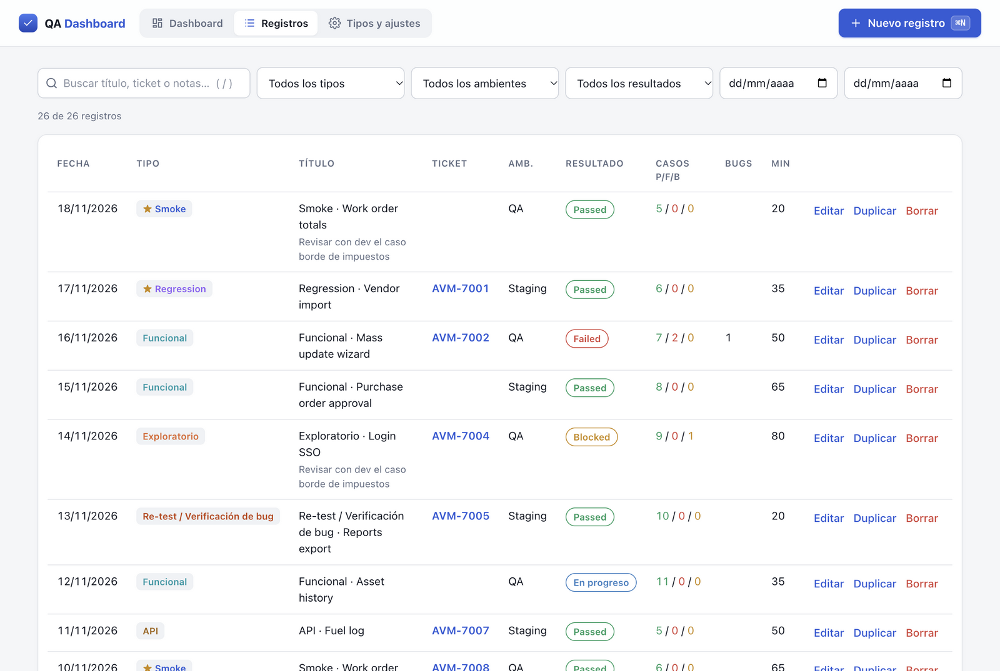

**Search and filter.** The search box (`⌘F` or `/`) searches title, ticket and notes. You can combine it with type, environment, result and a date range (from / to). **Clear filters** shows everything again.

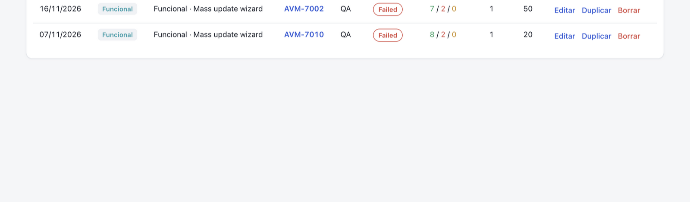

**Row actions:**

- **Edit**: opens the form with the run data.
- **Duplicate**: creates a new run with the same data and today's date. Useful to repeat a test (for example, the re-test of a bug).
- **Delete**: asks for confirmation. The button changes to **Confirm?** for 3 seconds; click it again to delete.

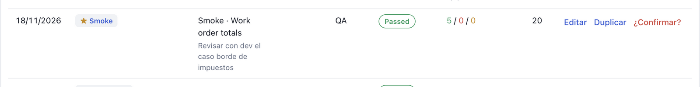

> Deleting cannot be undone. If you want a safety net, export a backup from time to time (section 9).

The tickets in the **Ticket** column are links: they open the ticket in Jira.

## 8. Customize test types and environments

In **Types & settings** (`⌘3`):

**Test types.**

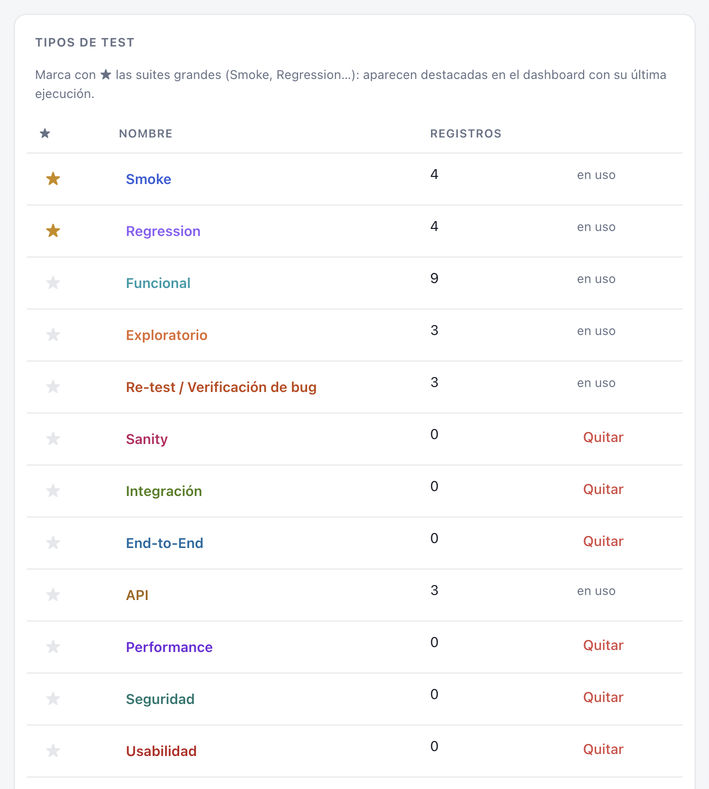

- Click a type's **★** to mark it as a large suite: it will be highlighted on the dashboard.
- Click a **name** to rename it; it is saved when you leave the field. Existing runs keep the type with the new name.
- **Remove** only appears on types with no runs ("in use" means it is already used). At least one type must always remain.
- Add your own types in the field below (for example "Data migration") and click **Add** or press `Enter`.

**Environments.**

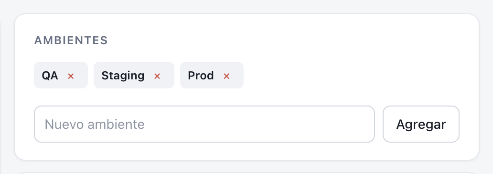

Add the environments you test on and remove the ones you do not use with the ×. Removing an environment does not change the runs that already use it.

**Ticket links.** The URL the ticket key is appended to in order to open it (for example `https://your-site.atlassian.net/browse/`). It is set automatically when you connect Jira.

**Sites & skills.** Where you test and with which Claude Code skills; none of this is hard-coded:

- **Sites**: each one with a short id (`qa`, `stg`…), name, URL, environment and the **Jira status** whose tickets are tested there. The Smoke card shows one button per site, and the orchestrator is offered only on tickets whose status matches a site's (by default, On QA → QA and On Staging → STG); the run takes that site's environment. To leave a site without the orchestrator, leave its Jira status empty.
- **Regression runs on**: the regression site (by default, STG).
- **Test run domains**: where regression links can come from (by default, `testomat.io`).
- **Claude Code skills**: the commands for the orchestrator, the smoke test and the regression.

Changes are saved together with **Save sites & skills**; **Restore defaults** brings back the AVM values. The app rejects invalid values (URLs that are not http(s), skills with spaces or quotes, repeated ids or Jira statuses) and explains why.

**Language.** English or Spanish (see [Language: English or Spanish](#language-english-or-spanish)).

**Appearance.** **Automatic** (follows the macOS light or dark mode), **Light** or **Dark**. You can also change it with the sun, moon or screen button in the header (each click moves to the next one) and, in the desktop app, from **View → Appearance**. The app window and menus follow the chosen theme.

## 9. Backup and export

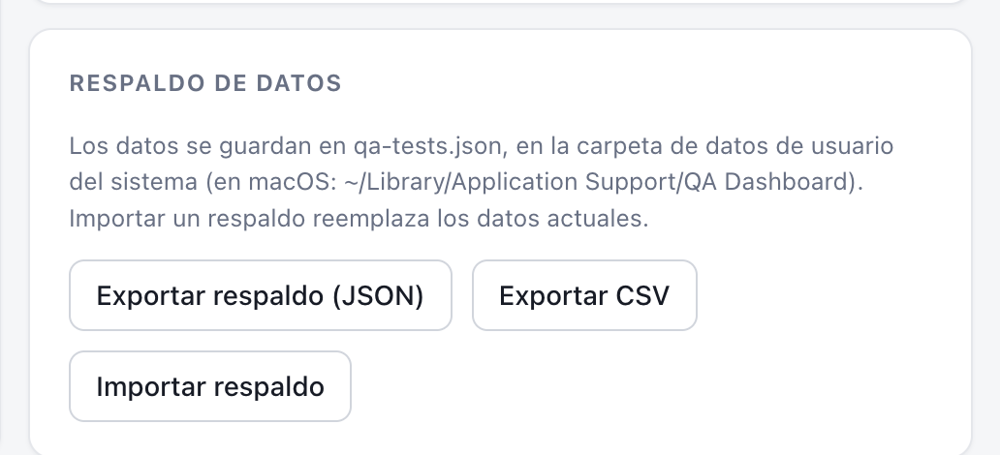

| Button | What it does |
| --- | --- |
| **Export backup (JSON)** | Saves a file (the app asks you where) with your runs, types, environments and ticket link. It does not include the Jira connection or the token. |
| **Export CSV** | Saves the runs as a table to open in Excel or Google Sheets. |
| **Import backup** | Loads a JSON backup. It **replaces** the current runs and settings; export first if in doubt. |

**Where the data is stored:** in `~/Library/Application Support/QA Dashboard/qa-tests.json` (macOS). Only your user can read the file, because it contains the Jira API token. Do not share it: to pass your runs to someone else, use **Export backup (JSON)**.

## 10. Keyboard shortcuts

They are also in the app's **File** and **View** menus.

| Shortcut | Action |
| --- | --- |
| `⌘N` or `N` | New run |
| `⌘1` | Dashboard |
| `⌘2` | Runs |
| `⌘3` | Types & settings |
| `⌘F` or `/` | Search runs |
| `⌘R` | Refresh Jira tickets |
| `⌘K` | Open or close the Claude assistant |
| `⌘↵` | Save the form |
| `Esc` | Close the form without saving |
| `⌘+` / `⌘-` / `⌘0` | Zoom in, zoom out, actual size |

Single keys (`N`, `/`) do nothing while you are typing in a field.

## 11. Troubleshooting

| Symptom | What to do |
| --- | --- |
| **"Jira rejected the credentials"** | Check the email and create a new token (tokens expire). Paste it in **API token** and save. |
| **"Jira could not find the board"** | Check the board link and that your user has access to that project. |
| **"The value 'X' does not exist for the field 'status'"** | A status in the extra JQL does not exist with that exact name (watch out for capitalization and accents). Fix it, for example "On Staging" and not "On Stagging". |
| **Connected, but "no tickets waiting to be tested"** | No open ticket matches the board filter + JQL. Try emptying the extra JQL to check. |
| **A ticket you expected is missing** | The app leaves out done tickets and loads at most 100. Adjust the filter to narrow it down. |
| **Tickets do not reflect recent changes** | The app refreshes them every 5 minutes and when you return to the window. To avoid waiting, click **Refresh from Jira** (`⌘R`). If the card shows **Connection error**, check the token. |
| **"Port 8765 is used by another program"** on launch | Another program is using that port. Close it, or open the app from Terminal with another port: `QA_DASH_PORT=8770 "/Applications/QA Dashboard.app/Contents/MacOS/QA Dashboard"`. |
| **"Claude Code (claude) was not found on this Mac"** | Install Claude Code (it goes to `~/.local/bin/claude`), sign in by running `claude` once in Terminal, and launch the run again. |
| **The run ends in BLOCKED with "no browser"** | Open Chrome, check that the **Claude in Chrome** extension is installed and connected to your Claude account, sign in to QA or STG, and launch the run again from the app. If you launched `claude` by hand, use `claude --chrome` or run `/chrome` inside the session. |
| **A run ends in BLOCKED "without reporting a result"** | Open its report: **Live activity · Log** has Claude's last steps and the path to the full log in `~/qa-dashboard-runs/logs/`. |
| **A report is still in its original language** | The translation failed (for example, with no connection). Open the report and click **Retry**. |
| **"Post on AVM-…" fails** | Check in **Types & settings** that Jira is connected: the comment is posted with the same email and API token. |
| **macOS says the app cannot be opened** | The first time, open it with **right-click → Open**. |
| **The app looks too big or too small** | `⌘0` goes back to actual size; `⌘+` / `⌘-` adjust the zoom. |
